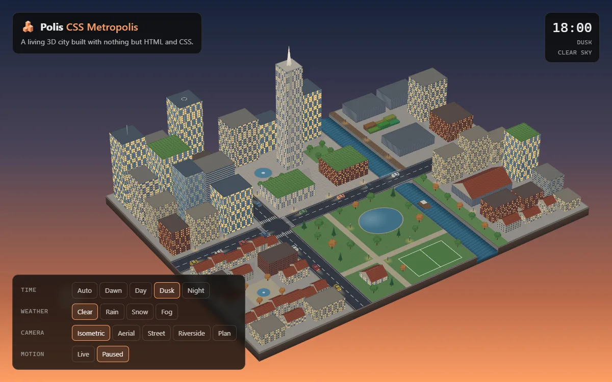
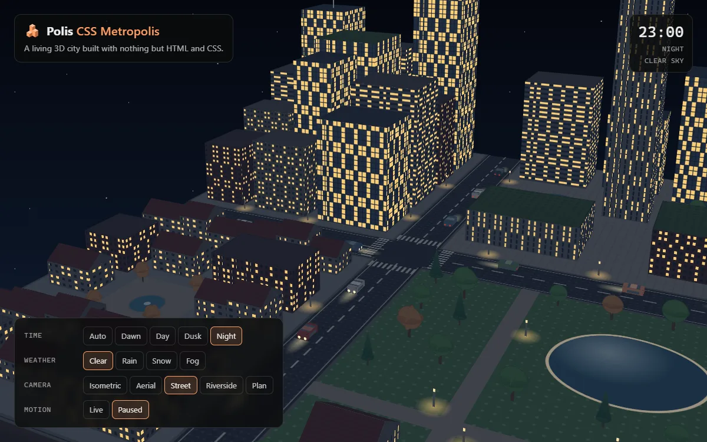
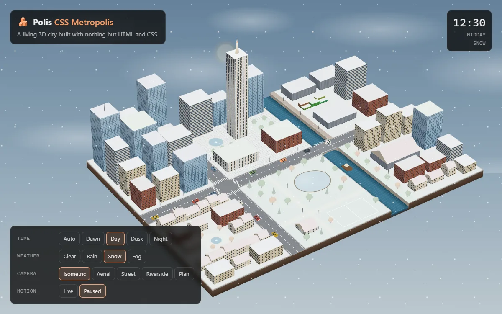
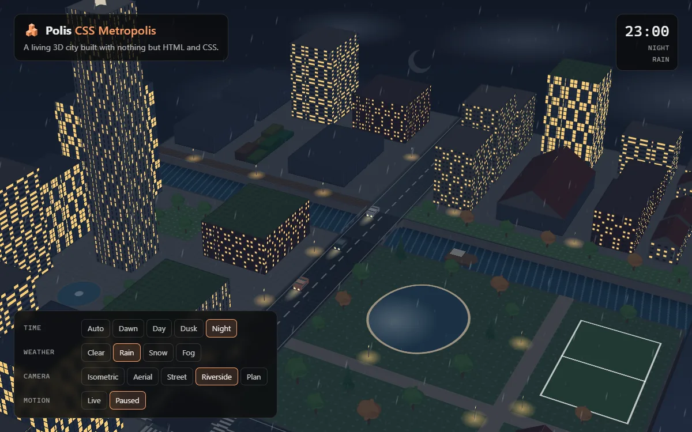

# Polis CSS Metropolis


A 3D city diorama with a day and night cycle, weather, camera presets and traffic, rendered from one HTML file and one stylesheet. No JavaScript runs on the page.

[](https://github.com/TIENDUNG21/polis-css-metropolis/actions/workflows/ci.yml)
[](LICENSE)

<p align="center"></p>

**Live:** https://tiendung21.github.io/polis-css-metropolis/



| Night, street camera | Snow | Rain at night, riverside |
| --- | --- | --- |
|  |  |  |

The screenshots come from the real page (`npm run screenshots`, headless Edge, 1200x750).

## What is shipped

The site is `index.html` (46 KB, 4.4 KB gzipped), `polis.css` (54 KB, 8.9 KB gzipped) and an SVG icon. Node, Dart Sass and Playwright are build and test tools only. `npm run check:dist` fails the build if the output contains a `<script>` element, any `on*` attribute, a `javascript:` URL in HTML, SVG or CSS `url()`, an embedded frame or object, a `.js` file, or a root-relative URL that would break under the GitHub Pages sub-path.

The page has 772 elements: six city blocks, 63 buildings (189 walls), 38 trees, 24 street lamps, 14 cars, a barge, three fog planes, the sky and the controls. Windows, road markings, rain and snow are gradients, not elements.

## How it works

### A preserve-3d scene graph

The viewport sets the perspective, a camera element holds the rotation and zoom, and a world element (a 1200 x 880 px plate on a 20 px tile grid) holds everything else. Blocks, buildings, trees and cars are positioned from inline custom properties in tile units, and each face is a flat element rotated into place:

```css
.bldg__wall--s {            /* south wall, rises from the footprint's south edge */
  top: calc(100% - var(--bh));
  height: var(--bh);        /* --bh: calc(var(--h) * 7px), floors to pixels */
  transform-origin: bottom;
  transform: rotateX(-90deg);
  backface-visibility: hidden;
}
```

Buildings have no north wall. Every camera preset keeps the spin between -90 and +90 degrees, so a north face would never be drawn; with back faces hidden, a box needs only the faces that can face the camera. That saves a quarter of the wall elements.

The HTML source uses build-time components so the city stays readable as data. The build expands them into plain elements and validates the layout:

```html
<polis-building x="5" y="5" w="5" d="5" h="30" kind="glass" roof="garden" seed="5"/>
```

```html
<div class="bldg bldg--glass" style="--x:5;--y:5;--w:5;--d:5;--h:30;--seed:5"><span class="bldg__wall bldg__wall--s"></span>
<span class="bldg__wall bldg__wall--e"></span><span class="bldg__wall bldg__wall--w"></span><span class="bldg__roof bldg__roof--garden"></span></div>
```

A building that overlaps another, leaves its block, or uses an unknown attribute stops the build at the source line:

```
build failed: src/partials/districts/downtown.html:7:3 building overlaps the building at line 6
```

### State without JavaScript

The controls are four groups of radio inputs. The page root reads them with `:has()` and turns them into world state: about twenty custom properties registered with `@property`, so each has a type.

```css
@property --night { syntax: "<number>"; inherits: true; initial-value: 0; }

.polis:has(input[name=time][value=night]:checked) {
  --hour: 23; --night: 1; --lights: 1; --sky-night: 1; --sun-height: 0; /* ... */
  animation: none;
}
```

Every system reads this state and nothing else: wall shading, window lights, sky layers, shadows, snow cover, the HUD clock. In Auto mode the same properties are written by a 96 s keyframe animation (4 s per in-game hour) that starts at 15:00 through a negative `animation-delay`. Choosing a preset removes the animation; because the properties are registered, the change interpolates as a transition instead of jumping. The clock is two registered integers animated with `steps()` and printed with CSS counters.

### Lighting

Surface colours go through one Sass function that mixes the base colour towards snow white by `--snow` and towards night ink by `--night` with `color-mix()`. Lit windows are a warm layer masked by the window grid intersected with two stripe patterns of coprime period combined with XOR (`mask-composite: exclude`), shifted per building by `--seed`. Buildings switch their lights on one by one at dusk because each wall's lit layer has its own threshold:

```css
opacity: clamp(0, (var(--lights) - var(--seed) * 0.08) * 6, 1);
```

Shadows follow the sun. A shadow is the footprint sheared away from the sun, `skewX(atan(...)) scaleY(...)` computed from unitless floors and tiles, drawn on one flat layer per block with `overflow: hidden` so long morning shadows stop at the block edge instead of hanging off the diorama.

### Traffic

Cars are boxes moved along `offset-path` routes generated from the road tokens, for example `path("M 0 445 H 1200")` for eastbound traffic on the main avenue. All routes share a 24 s period. Each car's negative delay places its pass through the junction in its avenue's half of the cycle (avenue A in the first 12 s, avenue B in the second), so crossing traffic never meets without any collision logic. A browser test steps all fourteen car animations through a full cycle in 0.2 s increments and checks that no two cars touch, that every car stays on its road, and that the two avenues never share the junction.

Cars grow out of the road at the world edge with `transform: scale3d()`. The `scale` property would not work here: individual transform properties apply after the offset-path placement, so they scale around the element's original position near the world origin. The traffic test caught exactly that.

### Weather

Rain and snow are 2D layers in front of the city. Each layer is one repeating tile of radial-gradient particles; two layers with different tile sizes and speeds read as random, and each moves exactly one tile per loop, so the loop has no seam. Fog is three translucent planes inside the 3D world at 8, 34 and 80 px, so it sits between the buildings. Snow cover is the same `--snow` property every surface already reads, with a 6 s transition to settle and to melt.

### Motion and accessibility

All rules that pause motion live in the last cascade layer, so they win over every system without `!important`. The Motion control pauses everything (WCAG 2.2.2), and `prefers-reduced-motion: reduce` starts the city paused and makes the camera cut instead of flying. Light and colour fades remain. There is no lightning, by design (WCAG 2.3.1). Inputs stay in the accessibility tree and keep native keyboard behaviour; the focus ring is drawn on the label. The city is one `role="img"` element labelled by a description of the scene.

See [docs/ARCHITECTURE.md](docs/ARCHITECTURE.md) for the module map and data flow, and [docs/adr](docs/adr) for the main decisions.

## Performance

Measured with `npm run stats` and `npm run measure` on an Intel i7-14700K, 32 GB RAM, Windows 11, in headless Microsoft Edge 157 at 1440x900. Edge reported GPU rendering (NVIDIA RTX 4060 through ANGLE/Direct3D 11). Frame times are `requestAnimationFrame` intervals over 10 s per scenario. Raw output: [docs/metrics](docs/metrics).

| Scenario | fps | median frame | p95 frame | frames over 33 ms |
| --- | ---: | ---: | ---: | ---: |
| Auto cycle, clear | 49.9 | 16.7 ms | 33.4 ms | 18 |
| Night, rain, street camera | 60.0 | 16.7 ms | 16.8 ms | 0 |
| Day, fog | 50.9 | 16.7 ms | 33.4 ms | 14 |
| Day, snow | 60.0 | 16.7 ms | 16.8 ms | 0 |
| Motion paused | 59.3 | 16.7 ms | 16.8 ms | 1 |

First Contentful Paint was 544 ms from the local server (Paint Timing API). The machine was running other build jobs at the same time, and repeated runs varied: fog measured between 27 and 51 fps. Two changes came out of earlier runs of the same script. The sun's position now moves in one-second steps, which raised Auto from about 39 fps, because a continuous change repainted every wall each frame. The 3D fog planes are now shown only in thick fog, which raised snow from about 28 fps.

Every `@keyframes` block animates only `transform`, `translate`, `rotate`, `scale`, `opacity`, `offset-distance` or a registered custom property; a unit test fails the build otherwise, and enforces budgets of 1000 elements and 20 KB of gzipped CSS.

## Browser support

The page needs `:has()`, `@property`, `color-mix()`, `offset-path: path()`, CSS trigonometric functions, cascade layers and unprefixed `mask-composite`. Only Microsoft Edge 157 on Windows and Playwright's Chromium on Linux are tested. Current Firefox and Safari implement these features, but the page has not been checked in them.

## Limitations

- Performance depends on the GPU. The scene is one 3D rendering context, and because cars move inside it, the browser re-sorts its planes every frame; the fog planes intersect every tall building, which makes that sort more expensive.
- Changes of light during dawn and dusk, and preset transitions, repaint every face for their duration.
- The city is authored, not generated, and the camera fits it in discrete steps by viewport width.
- Cars do not turn; traffic is a schedule, not a simulation.
- Screen readers get one description of the scene, not its contents. The HUD clock is CSS-generated text and is hidden from assistive technology; the radio inputs announce the state.

## Roadmap

- Test in Firefox and Safari, and add their Playwright projects to CI.
- Cheaper fog: fewer or smaller planes, or a 2D layer per depth band, to keep fog at 60 fps on mid-range GPUs.
- Turning traffic at the junction, with a schedule finer than two halves.
- A watch mode for development (`npm run dev`); today the loop is `npm run build` and reload.

## Building from source

Requires Node 22. The browser tests use the installed Microsoft Edge locally and Playwright's Chromium on CI (`npx playwright install chromium`).

```
npm ci
npm run build          # src/ + scss/ -> dist/
npm run serve          # http://127.0.0.1:5180/polis-css-metropolis/
npm run verify         # stylelint, ESLint, tsc --checkJs, unit tests, build, dist check, html-validate
npm run test:e2e       # Playwright browser tests
npm run stats          # static metrics -> docs/metrics/static.json
npm run measure        # frame times in a browser -> docs/metrics/runtime.json
npm run screenshots    # README images -> docs/screenshots/
```

```
src/          index.html, partials, districts (HTML with build-time components)
scss/         core/ city/ systems/{daynight,weather,traffic,camera}/ ui/ a11y/
tools/        build, component expander, dist checker, static server, metrics
tests/unit    node:test: checker, components, includes, Sass functions, budgets
tests/e2e     Playwright: layout, traffic schedule, day/night, weather, a11y, screenshots
```

## Tests

85 unit tests (`node:test`) cover the dist checker against obfuscated script injections (entity-encoded and whitespace-split `javascript:` schemes, unquoted and uppercase handlers, CSS escapes), every component validation rule with its line and column, include cycles, the Sass functions, Sass warnings failing the build, the static server's path handling, and the keyframe audit and budgets. 33 browser tests check the city plan from untransformed layout boxes, the traffic schedule over a full cycle, every time and weather preset, keyboard use, the pause control, reduced motion, the phone layout, and screenshot properties: night is darker than dusk and dawn, snow brightens the city, each camera preset frames it differently. They assert properties of images rather than pixel baselines, which would differ between Edge on Windows and Chromium on Linux.

## References

- CSS Transforms Module Level 2, W3C (3D transforms, `transform-style`, individual transform properties).
- CSS Motion Path Module Level 1, W3C (`offset-path`, `offset-distance`, `offset-rotate`).
- CSS Properties and Values API Level 1, W3C (`@property`).
- Selectors Level 4, W3C (`:has()`).
- CSS Cascading and Inheritance Level 5, W3C (cascade layers).
- CSS Color Module Level 5, W3C (`color-mix()`); CSS Values and Units Module Level 4, W3C (trigonometric functions).
- Web Content Accessibility Guidelines 2.2, W3C: 2.2.2 Pause, Stop, Hide; 2.3.1 Three Flashes or Below Threshold.

## License

MIT, see [LICENSE](LICENSE).
