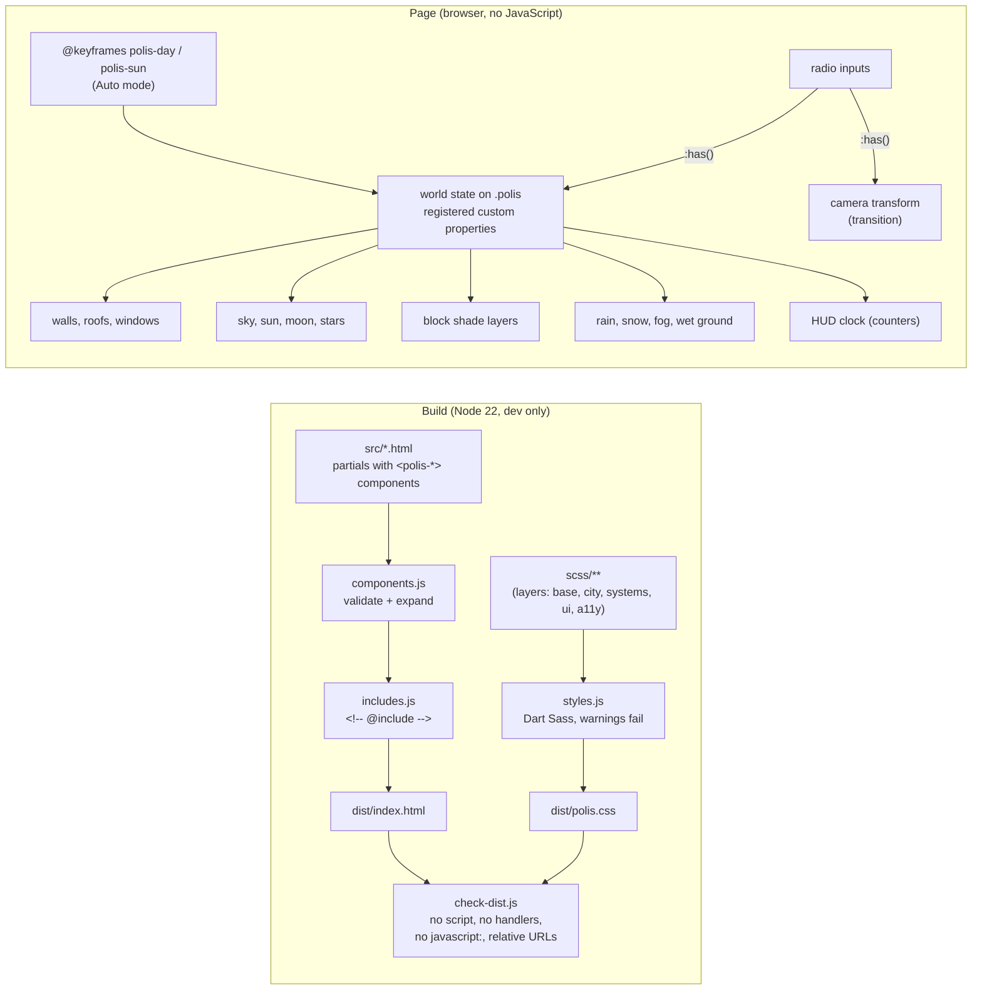

# Architecture

Polis has two halves that never meet at runtime: a Node build that turns HTML partials and SCSS into two static files, and the page those files describe, which the browser animates on its own.



## The page

### Scene graph

```
.stage
  .sky                 2D gradient layers, stars, sun/moon orbit, clouds
  .scene
    .viewport          perspective
      .camera          translate, rotateX(tilt), rotateZ(spin), scale3d(zoom), translate(-focus)
        .world         1200 x 880 px plate, preserve-3d
          .land x2     slab tops (asphalt) with hanging S/E/W sides
          .river       sunk 14 px, barge inside
          .bridge      deck at street level, railings, arched fascia
          .block x6    pavement or grass; contain .block__shade, buildings, trees, lamps, features
          .road, .junction, .car x14
          .fog x3      planes at z = 8, 34, 80 px
  .weather             2D rain and snow layers, haze
  .hud                 clock, mode, weather (aria-hidden)
  .console             radio groups: time, weather, camera, motion
```

Everything inside `.world` is in one 3D rendering context. Geometry comes from custom properties written by the build (`--x --y --w --d` in tiles of 20 px, `--h` in floors of 7 px), so the SCSS for a building is the same whatever its size. Faces are flat elements rotated about one edge; back faces are hidden, so each convex box draws only the faces that point at the camera. Camera spin is limited to (-90, 90) degrees, which is why buildings have south, east and west walls but no north wall.

### World state

The only coupling between systems is a set of registered custom properties on `.polis` (`scss/core/_properties.scss`): `--night`, `--lights`, the four `--sky-*` weights, `--sun-turn`, `--sun-x`, `--sun-height`, `--hour`, `--minute`, `--cloud`, `--rain`, `--snowfall`, `--wet`, `--snow`, `--fog`, and the three wall shades derived from the sun.

Writers:

- Radio inputs, through `.polis:has(input[name=…][value=…]:checked)` rules generated by the `when()` mixin.
- In Auto mode, `polis-day` (light and sky, linear), `polis-sun` (sun side and height, one step per second), `polis-hours` and `polis-minutes` (integers, stepped). A preset sets `animation: none` and fixed values.
- `scss/systems/_transitions.scss` sets one `transition` list for all of them. It is a single declaration because a second `transition` on `.polis` would replace the first rather than add to it.

Readers never write state. A wall reads `--shade-*`, `--night` and `--lights`; a roof reads `--snow`; a shade layer reads `--sun-height`, `--cloud` and `--night`; the sky layers read `--sky-*`; and so on. Adding a system means adding readers.

### Cost model

Per frame, the browser does the following.

- Cars and the barge: `offset-distance` and `transform`. Main-thread style updates, no repaint.
- Rain, snow, clouds, fog drift: `transform` on composited layers.
- Day cycle: during the plateaus (full day, full night) `polis-day` produces the same values every frame and nothing repaints. During dawn and dusk, and during preset transitions, every face that mixes colours with `--night` repaints. The sun moves in steps for the same reason: a continuous `--sun-x` changed every wall's shade each frame.
- The 3D context is re-sorted every frame because cars move inside it. Large planes that intersect buildings (fog) make the sort and the overdraw more expensive, so fog planes are only visible in the Fog preset.

`tests/unit/stats.test.js` fails if a keyframe animates anything other than transforms, opacity, `offset-distance` or a registered property.

### Cascade layers

`scss/main.scss` registers properties globally, then loads every module into `@layer base, city, systems, ui, a11y`. The `a11y` layer pauses animations for the Motion control and for `prefers-reduced-motion`; being last, it wins over each system's own `animation-play-state` rules regardless of their specificity.

## The build

| Module | Responsibility |
| --- | --- |
| `tools/lib/markup.js` | Tolerant tag and attribute scanner with source offsets; skips comments, reads raw-text elements. |
| `tools/lib/components.js` | Component definitions, attribute types, placement rules (inside the world, inside the block, no overlaps), expansion to plain HTML. |
| `tools/lib/includes.js` | Inlines `<!-- @include path -->` per file after expansion, so errors keep the partial's own line numbers; detects cycles. |
| `tools/lib/styles.js` | Dart Sass compile; any warning, including deprecations, is a build error with its position. |
| `tools/lib/check-dist.js` | The zero-JavaScript and relative-URL checks over `dist/`. |
| `tools/lib/serve.js` | Static server mounted at `/polis-css-metropolis/`, like GitHub Pages; used by tests and tools. |
| `tools/lib/stats.js` | Element counts, transfer sizes, keyframe audit. |

The build is `node tools/build.js`: expand and include HTML, compile SCSS, copy the logo as the favicon. CI then runs the dist check and html-validate.

## Testing

- Unit tests (`node:test`) cover the build tools and the Sass functions, including hostile markup for the checker and every component error with its position.
- Browser tests (Playwright) run against the built site under the Pages sub-path: Microsoft Edge locally, Chromium on Linux in CI. They read untransformed layout boxes to check the city plan, use the Web Animations API to step the traffic through a full cycle, read registered property values after transitions settle, read the HUD clock from Chromium's accessibility tree (its text is generated by CSS counters), and check properties of screenshots instead of pixel baselines.

## Decisions

- [0001 Build-time components](adr/0001-build-time-components.md)
- [0002 World state as registered custom properties](adr/0002-world-state-registered-properties.md)
- [0003 Slot-scheduled traffic](adr/0003-slot-scheduled-traffic.md)
- [0004 Screenshot properties instead of pixel baselines](adr/0004-screenshot-properties.md)
